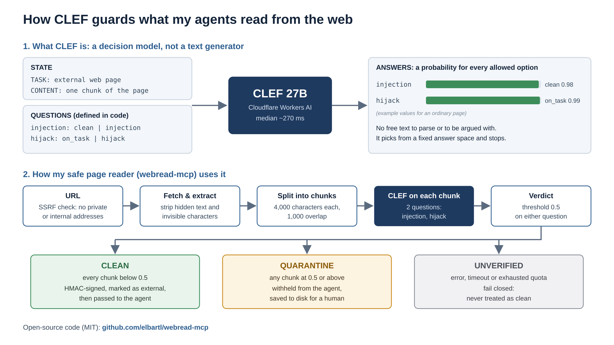

# webread-mcp

[](https://github.com/elbartl/webread-mcp/actions/workflows/ci.yml)
[](LICENSE)
[](package.json)

**webread-mcp** is a secure, standalone webpage reader Model Context Protocol (MCP) server. It fetches and extracts clean, readable text from arbitrary websites while protecting Artificial Intelligence (AI) assistants against Server-Side Request Forgery (SSRF), hidden text manipulation, and prompt injection or hijacking attacks.

## How It Works



CLEF is a decision model, not a text generator: for each chunk it answers two questions defined in code (`injection: clean | injection`, `hijack: on_task | hijack`) with a probability per option. A score of 0.5 or more on either question quarantines the page. Errors, timeouts and an exhausted quota return `unverified`, never `clean`.

---

## Key Features

- **Model Context Protocol (MCP) Standard:** Exposes the `web_read` tool over standard input/output (stdio) JSON-RPC (JavaScript Object Notation Remote Procedure Call).
- **Strict SSRF Protection:** Validates URLs and blocks private IPv4 and IPv6 addresses, loopback, link-local, Carrier-Grade Network Address Translation (CGNAT), and multicast ranges.
- **DNS Rebinding Prevention:** Performs Domain Name System (DNS) lookups on all resolved IP addresses and pins connections directly to the validated IP.
- **Hidden Content Stripping:** Removes HTML comments, invisible Unicode characters, bidirectional override sequences, and CSS (Cascading Style Sheets) / HTML-hidden text (e.g. `display:none`, `opacity:0`, `aria-hidden="true"`).
- **Prompt Injection & Hijack Scanning:** Analyzes text using pluggable scanner backends:
  - **`clef` (Default):** Cloudflare Workers AI `@cf/cloudflare/clef` model with automated chunking and daily neuron budget enforcement.
  - **`ollama`:** Local Large Language Model (LLM) backend via Ollama HTTP API (e.g. `qwen3:4b`).
  - **`none`:** Explicit pass-through mode with visible security warnings.
- **Cryptographic Verification:** Envelopes clean content inside `<external-source>` tags and signs output using Hash-based Message Authentication Code (HMAC-SHA256).
- **Privacy & Anonymization:** Redacts private IP addresses, emails, and custom sensitive identifiers before sending text to cloud inspection backends.
- **Zero External Dependencies:** Built entirely with Node.js built-in standard library modules (`node:http`, `node:https`, `node:crypto`, `node:dns`, `node:test`). Requires Node.js >= 20.

---

## Threat Model & Limitations

`webread-mcp` is designed as defense-in-depth for AI agents reading external web pages. However, it is not a silver bullet. Understand what it protects against and what it **does NOT** protect against:

### What It Protects Against
1. **Server-Side Request Forgery (SSRF):** Prevents the agent from accessing local services (e.g. `127.0.0.1`, `169.254.169.254`, `10.0.0.0/8`, `172.16.0.0/12`, RFC 1918 private blocks, `localhost`, `.local`, `.internal`).
2. **DNS Rebinding Attacks:** Validates every resolved IP and locks the HTTP socket to that exact IP.
3. **Hidden / Invisible Injection Payloads:** Strips invisible Unicode characters (zero-width characters, bidi-overrides, tags) and CSS-concealed HTML text intended only for AI parsers.
4. **Obvious or Adversarial Prompt Injections:** Flags commands attempting to hijack system prompts, exfiltrate credentials, or execute arbitrary tools.

### What It DOES NOT Protect Against
- **Client-Side JavaScript Rendering:** `webread-mcp` performs HTTP fetches without running a headless browser. Single Page Applications (SPAs) that require JavaScript execution to generate text will return empty or static fallback HTML.
- **Images, Audio, and Video:** Non-text media assets are not downloaded, processed, or scanned.
- **PDFs and Binary Documents:** Binary files are rejected based on content-type allowlisting (only text formats, JSON, HTML, and XML are accepted).
- **Subtle, Context-Aware Manipulation:** If an attacker writes deceptive or socially engineered text that reads as normal factual documentation, machine learning classifiers may assess it as clean. Prompt injection scanning is probabilistic.

---

## Quickstart

Run the server directly via `npx`:

```bash
npx -y webread-mcp
```

Or verify your local configuration with the self-test command:

```bash
npx -y webread-mcp self-test
```

---

## MCP Client Configuration

### Claude Code
Add the tool via the Claude command line:
```bash
claude mcp add webread -- npx -y webread-mcp
```

### Claude Desktop
Add to your `claude_desktop_config.json` file:

```json
{
  "mcpServers": {
    "webread": {
      "command": "npx",
      "args": ["-y", "webread-mcp"],
      "env": {
        "WEBREAD_SCANNER": "clef",
        "CF_ACCOUNT_ID": "your_cloudflare_account_id",
        "CF_API_TOKEN": "your_cloudflare_api_token"
      }
    }
  }
}
```

### Cursor
Add to your Cursor MCP settings (`.cursor/mcp.json`):

```json
{
  "mcpServers": {
    "webread": {
      "command": "npx",
      "args": ["-y", "webread-mcp"],
      "env": {
        "WEBREAD_SCANNER": "ollama",
        "OLLAMA_URL": "http://127.0.0.1:11434",
        "WEBREAD_OLLAMA_MODEL": "qwen3:4b"
      }
    }
  }
}
```

> [!NOTE]
> When using the `ollama` backend, ensure the target model is downloaded beforehand by running `ollama pull <model>` (e.g. `ollama pull qwen3:4b` or `ollama pull qwen3:4b-instruct`), or configure `WEBREAD_OLLAMA_MODEL` to match an already installed model. The `webread-mcp self-test` command verifies model existence via `/api/tags`.

### Generic MCP Client
`webread-mcp` communicates over standard input and standard output (stdio) using JSON-RPC 2.0. Any client supporting the Model Context Protocol specification can execute the command `npx -y webread-mcp`.

---

## Agent skill

A ready-to-use agent skill (`skills/webread/SKILL.md`) teaches AI assistants when and how to use `web_read` and how to safely handle verdicts. To install it, copy the `skills/webread/` directory to `~/.claude/skills/webread/` (Claude Code) or to your agent's skills directory.

---

## The `web_read` Tool

### Tool Signature
- **`url`** (string, required): Full HTTP or HTTPS webpage URL.
- **`max_chars`** (integer, optional, default: 60000): Maximum character length of extracted text.

### Three Output States
Every response returns a structured result containing a `verdict` and `scanned` indicator:

1. **`clean` (`ok: true`):**
   - Content fetched, extracted, and passed scanner inspection.
   - Text is enclosed in an `<external-source>` envelope and stamped with an HMAC signature.
2. **`quarantine` (`ok: false`):**
   - The scanner detected a prompt injection or hijack attempt.
   - The malicious payload is **withheld** from the AI context and quarantined to disk in the state directory for investigation.
3. **`unverified` (`ok: false`):**
   - The content could not be verified due to a network error, HTTP fetch failure, scanner timeout, exceeded neuron budget, or emergency disable switch.
   - Fail-closed guarantee: any failure produces `unverified`, **never** `clean`.

---

## Environment Variables

| Variable | Description | Default |
| -------- | ----------- | ------- |
| `WEBREAD_SCANNER` | Scanner backend: `clef`, `ollama`, or `none`. | `clef` |
| `CF_ACCOUNT_ID` | Cloudflare Account ID (for `clef`). | *None* |
| `CF_API_TOKEN` | Cloudflare Workers AI API token (for `clef`). | *None* |
| `WEBREAD_CLEF_API_BASE` | Custom Cloudflare API base URL. | `https://api.cloudflare.com` |
| `WEBREAD_DAILY_NEURONS` | Daily Cloudflare neuron budget. | `2000` |
| `OLLAMA_URL` / `WEBREAD_OLLAMA_URL` | Ollama HTTP endpoint URL. | `http://127.0.0.1:11434` |
| `WEBREAD_OLLAMA_MODEL` | Ollama model identifier. | `qwen3:4b` |
| `WEBREAD_STATE_DIR` | Directory for state, keys, quarantine, and budget. | `~/.local/state/webread` |
| `WEBREAD_HMAC_KEY` | Custom 256-bit hexadecimal HMAC key (optional). | *Auto-generated in state dir* |
| `WEBREAD_ANONYMIZE_FILE` | Path to JSON file containing redaction rules. | *None (built-ins active)* |
| `WEBREAD_TIMEOUT_MS` | Timeout in milliseconds for webpage fetching. | `15000` |
| `WEBREAD_SCAN_TIMEOUT_MS` | Timeout in milliseconds for prompt injection scanner calls (must be positive). | `20000` (`clef`), `90000` (`ollama`) |
| `WEBREAD_DISABLED` | Emergency kill switch (`1` disables scanning). | `0` |

---

## Budget & Cost Control (Cloudflare Workers AI)

When using the `clef` backend, Cloudflare charges based on "Neurons" consumed by Workers AI:
- `webread-mcp` tracks consumption locally in `$WEBREAD_STATE_DIR/budget.json` under an atomic filesystem lock (`budget.lock`).
- Neurons are estimated and **reserved before** dispatching requests to prevent race conditions across parallel calls.
- Once the daily neuron limit (`WEBREAD_DAILY_NEURONS`, default 2000) is reached, requests return `verdict: "unverified"` without performing external cloud calls.
- Counters automatically reset at 00:00 UTC.

---

## CLI Commands

The `webread-mcp` binary provides several helper modes:

- `webread-mcp`: Launches the stdio MCP server.
- `webread-mcp --version`: Displays package version.
- `webread-mcp self-test`: Verifies Node version, state directory permissions, HMAC key, and scanner configuration.
- `webread-mcp anonymize-test <file>`: Tests anonymization rules against a text file.
- `webread-mcp verify <file>`: Cryptographically verifies an HMAC-signed output envelope.

---

## License

MIT License. See [LICENSE](LICENSE) for details.
